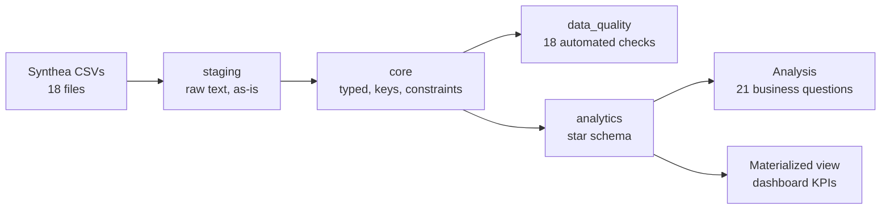
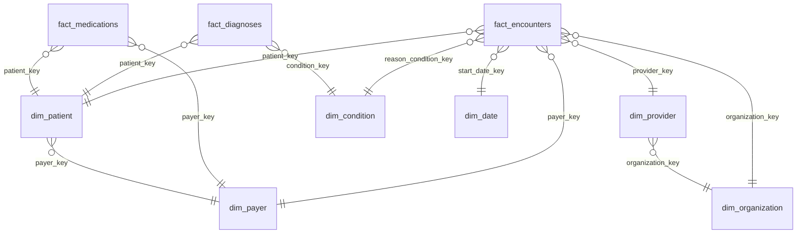

# Healthcare Analytics Data Warehouse

An end-to-end healthcare data warehouse built in **PostgreSQL**. It takes raw synthetic electronic health record (EHR) data, cleans and validates it, models it as a star schema, and answers clinical, operational and financial questions such as 30-day readmission rates, uninsured patients' out-of-pocket costs, and where spending is concentrated.

**[View the live dashboard →](https://rachnamunagala6.github.io/healthcare-analytics-dw/)**

**Stack:** PostgreSQL 18 · SQL / PL/pgSQL · pgAdmin · Synthea · Git · HTML/JavaScript (dashboard)

> All patient data is **synthetic** (generated with [Synthea](https://github.com/synthetichealth/synthea)). No real patient information is used.

---

## Key findings

| Area | Finding |
|---|---|
| Readmissions | **12.3%** of inpatient stays were followed by another admission within 30 days. |
| Readmission cost | 30-day readmissions accounted for **25.0%** of all inpatient spending (**$7.8 million**), twice their share of stays, so each readmission is costlier than an average stay. |
| Uninsured patients | Uninsured patients paid **4.2×** more out of pocket per visit than insured patients. For an inpatient stay, that was **$17,225 vs $3,301**. |
| Cost concentration | Just **12.2%** of patients accounted for **half** of all healthcare costs. |
| Blood sugar (A1C) | Of patients with A1C tests, **5.4%** were above the 7% target at their latest test, and **6.8%** saw their A1C rise by 0.5 points or more over time. |
| Preventive care | **16.6%** of living patients were overdue for a flu vaccine. |
| Data quality | 18 automated checks flagged **443** records for review, including **150 visits** and **218 lab results** dated after the patient's death. |
| Performance | Indexing made key queries up to **22.4×** faster, and a materialized view made the KPI dashboard **532×** faster. |

> **A note on readmissions by condition:** the highest rate was for stage 1 small cell lung cancer (about 91%). That rate rests on few patients, and cancer readmissions are often *planned* treatment cycles rather than unplanned returns, which is why real-world readmission measures exclude planned admissions.

---

## Architecture



| Layer | Purpose |
|---|---|
| `staging` | Raw CSVs loaded exactly as delivered (all `TEXT`) so no row is rejected at load time |
| `core` | Cleaned and typed data: 13 tables with primary keys, foreign keys and `CHECK` constraints. Direct identifiers (SSN, license, passport) are deliberately left out. |
| `data_quality` | Rule-driven checks, run by a stored procedure that logs every failing record |
| `analytics` | Star schema for reporting: 3 fact tables, 6 dimensions |
| `audit` | Change log populated by triggers |
| `perf` | Benchmarking framework used to measure tuning |

### Star schema



**Design decisions**
- **Type 2 slowly changing dimension:** `dim_patient` keeps a new version of a patient every time their insurance changes (`effective_from`, `effective_to`, `is_current`). Facts join to the version in effect on the date of the event, so a 2015 visit is reported under the patient's 2015 insurer. Consecutive periods on the same payer are merged with a gaps-and-islands query.
- **"Unknown" members:** every dimension has a key of `-1`, so facts never have null foreign keys and no rows are silently lost in joins.
- **Incremental loading:** `fact_encounters` is loaded by a stored procedure using `INSERT ... ON CONFLICT DO UPDATE`. It inserts new visits, updates changed ones and skips unchanged ones.
- **Reconciliation:** every build compares row counts and dollar totals between `core` and the warehouse.

---

## Data quality

`data_quality.run_dq_checks()` runs **18 rules** across 5 categories (validity, consistency, uniqueness, completeness, plausibility) and logs every failing record ID, so each issue can be traced. Rules are stored as rows in a table, so adding a check needs no code change.

Examples: visits that end before they start, records dated after a patient's death, insurers paying more than the bill, duplicate diagnoses, and implausible vital signs.

Result on this dataset: **443 issues** found across **443 records**.

---

## Analysis (21 questions)

| File | Questions |
|---|---|
| [`05_clinical_analysis.sql`](analysis/05_clinical_analysis.sql) | 30-day readmission rate · readmissions by reason · readmission chains · chronic disease prevalence by age and gender · A1C trends · flu vaccine gaps · common condition pairs |
| [`06_operational_analysis.sql`](analysis/06_operational_analysis.sql) | Monthly volume with moving average · length of stay (median, 90th percentile) · provider workload rankings · ER high utilizers · ER volume by weekday · yearly volume with subtotals |
| [`07_financial_analysis.sql`](analysis/07_financial_analysis.sql) | Payer mix · uninsured out-of-pocket burden · year-over-year cost growth · spending concentration (Pareto) · top medications by cost · cost of readmissions |

**SQL techniques used:** CTEs · recursive CTE · window functions (`LAG`, `LEAD`, `RANK`, `DENSE_RANK`, `NTILE`, `FIRST_VALUE`, `PERCENT_RANK`, running totals, moving averages) · `PERCENTILE_CONT` · `GROUP BY ROLLUP` with `GROUPING()` · pivots with `FILTER` · anti-joins (`NOT EXISTS`) · self-joins · gaps and islands

---

## Performance tuning

A benchmarking framework (`perf` schema) times six representative queries before and after tuning, using the average of 5 runs after a warm-up.

**Results:** indexing made queries up to **22.4× faster**, and the materialized view served dashboard KPIs **532× faster** than computing them live.

| Technique | Applied to |
|---|---|
| Covering index (`INCLUDE`), index-only scan | A1C lab history |
| Composite index `(patient_id, start_ts DESC)` | Patient visit timeline |
| Partial index (inpatient rows only) | Readmission analysis |
| Foreign key indexes (PostgreSQL does not create these automatically) | Diagnosis, medication and immunization lookups |
| Range partitioning by year, with partition pruning | Lab results and vitals |
| Materialized view with `REFRESH ... CONCURRENTLY` | Monthly dashboard KPIs |

Benchmarking note: the timing function references every result column, because PostgreSQL otherwise skips work whose result is discarded, which produces misleadingly fast timings.

---

## Security and auditing

- **Audit trail:** triggers on `core.patients` and `core.encounters` log every insert, update and delete, recording who, when, before and after values (JSONB) and which columns changed.
- **Least-privilege roles:** `hc_etl` builds the pipeline. `hc_analyst` can read only the analytics layer, using column-level privileges and a de-identified patient view, and has no access to patient IDs, birth dates or raw tables.
- **Automated permission tests:** the script switches into the analyst role and verifies 10 allowed and blocked actions. All 10 pass.

---

## How to run

1. Generate data with Synthea (FHIR off saves a lot of disk space):
   ```
   java -jar synthea-with-dependencies.jar -p 1000 --exporter.csv.export=true --exporter.fhir.export=false Michigan
   ```
2. Put the CSVs in `/Users/Shared/synthea_csv/` (or edit the paths in `01_load_staging.sql`).
3. Run the scripts in order in pgAdmin or psql:

| # | Script | What it does |
|---|---|---|
| 00 | `schema/00_setup.sql` | Creates the database and schemas |
| 01 | `etl/01_load_staging.sql` | Loads 18 CSVs into staging |
| 02 | `etl/02_build_core.sql` | Builds the typed, constrained core layer |
| 03 | `data_quality/03_data_quality.sql` | Runs the data quality checks |
| 04 | `warehouse/04_build_warehouse.sql` | Builds the star schema |
| 05–07 | `analysis/` | Clinical, operational and financial analysis |
| 08 | `performance/08_performance.sql` | Benchmarks, indexes, partitioning, materialized view |
| 09 | `security/09_security_audit.sql` | Audit triggers, roles and permission tests |

| 10 | `analysis/10_readme_numbers.sql` | Collects the headline numbers in this README |
| 11 | `analysis/11_dashboard_export.sql` | Exports the dashboard data as one JSON value |

Every script can be re-run safely. The dashboard (`docs/index.html`) is a single self-contained page; to refresh it, paste a new export from script 11 into its data block.

---

## Dataset

- **1,162 patients** with **72,557 encounters**, **909,251 lab results and vitals**, and **41,988 diagnoses**
- **2.7 million raw rows** loaded across 18 source files
- Generated with Synthea for Michigan
